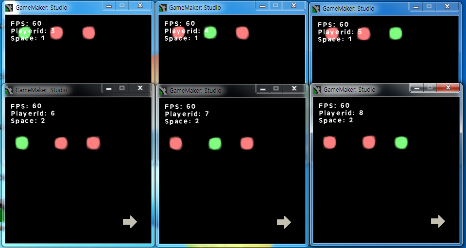

# Networking with Space

게임메이커: 스튜디오로 멀티플레이 게임과 온라인 게임을 만들게 해 주는 네트워크 확장(`.gmez`)이다. 게임메이커: 스튜디오의 `network_*` 함수 위에서 서버 열기와 접속, 플레이어 id, 메시지 송수신을 스크립트로 감쌌고, 접속한 플레이어를 공간(space)으로 나눠 메시지가 정한 공간 안에서만 오가게 한다. 클라이언트가 보내는 패킷에 SHA-1 해시를 붙여 변조된 패킷을 거르는 기능과, 클라이언트끼리 UDP 로 직접 주고받는 Networking with Space UDP, 인스턴스마다 네트워크 id 를 붙여 메시지를 나눠 주는 Instance Message 가 함께 들어 있다. YoYo Games Marketplace 에 올려 배포했다.

<p>
  
</p>


## 사용 방법

Releases에서 받은 압축 파일에는 확장(`.gmez`)과 예제 프로젝트, 함수 설명이 들어 있다. 게임메이커: 스튜디오에서 프로젝트의 Extensions 에 확장을 불러오면 스크립트와 함께 서버, 클라이언트, 공간 이동을 보여 주는 예제 오브젝트와 룸이 들어온다. IME 와 UDP 예제 프로젝트(`.gmz`)도 이 확장을 불러와야 실행된다.

서버는 `ns_create_server`, 클라이언트는 `ns_create_client_async` 로 TCP 핸들을 얻는다. 공간 개수와 자기가 들어갈 공간, 메시지를 받을 인스턴스, 버전 문자열, 해시 길이와 키를 이때 정한다.

```gml
var port, maxclients, spacenumber, joinspace, recvinstance, version, hashlen, key;
port = 12567 //1~65535
maxclients = 6 //1~1000. This is fixed maximum. You can't exceed this init value by ns_set_max_clients()
spacenumber = 4 //1~32767
joinspace = 0 //0~(spacenumber-1)
recvinstance = id //Message receive instance
version = "The Particles"
hashlen = 10 //Hash size(1~40), zero means do not use security
key = "MyKey" //Hash key(it can't exceed hashlen size)

buffer_seek(NsSendBuffer, buffer_seek_start, 0) //Server can read this buffer in the TypeServerCreated by NsRecvBuffer
tcp_handle = ns_create_server(port, maxclients, spacenumber, joinspace, recvinstance, version, hashlen, key)
```

보낼 값은 `NsSendBuffer` 에 쓰고, 받을 공간과 받을 사람, 메시지 id 를 붙여 보낸다. 아래는 예제 클라이언트가 매 스텝 자기 좌표를 같은 공간의 다른 플레이어에게 보내는 코드다.

```gml
buffer_seek(NsSendBuffer, buffer_seek_start, 0)
buffer_write(NsSendBuffer, buffer_u16, x)
buffer_write(NsSendBuffer, buffer_u16, y)
ns_message_send(obj_network.tcp_handle, ToMySpace, SendToAll, NS.CLIENT_POSITION)
```

받을 공간은 `ToMySpace`, `ToEverySpace`, `ToOtherSpace` 나 공간 번호, 받을 사람은 `SendToServer`, `SendToAllServerMe`, `SendToAllServer`, `SendToAllMe`, `SendToAll`, `SendToOther` 나 플레이어 id 다.

받는 인스턴스의 Asynchronous Networking 이벤트에서 `ns_message_receive_in_async()` 를 호출하면 메시지는 User Defined 0 으로, 서버에서 생긴 일(서버 생성, 클라이언트 접속과 퇴장, 공간 이동, 해시 불일치)은 User Defined 1 로, 클라이언트에서 생긴 일(접속 성공과 실패)은 User Defined 2 로 뜬다. 이벤트 안에서는 `NsMsgId`, `NsMsgSentPlayer`, `NsMsgSentSpace`, `NsMsgType` 으로 무슨 일인지 알고 `NsRecvBuffer` 에서 값을 읽는다.

```gml
///Message Event
switch(NsMsgId)
{
    ...
    case NS.CLIENT_POSITION:
        with(obj_client)
        {
            if(control==NsMsgSentPlayer)
            {
                x = buffer_read(NsRecvBuffer, buffer_u16)
                y = buffer_read(NsRecvBuffer, buffer_u16)
                break
            }
        }
        break
    ...
}
```

플레이어는 `ns_set_space` 로 공간을 옮기고, 그때 서버에 User Defined 1 의 `TypeClientSpaceChanged` 가 뜬다. 함수 전체의 인자와 이벤트 값은 [docs/reference.ko.md](docs/reference.ko.md) 에 있다.

예제는 다섯 가지다. 확장에 든 예제는 서버를 열거나 접속한 뒤 방향키로 자기 점을 움직이고, 오른쪽 아래 화살표에 닿으면 공간 1, 2, 3 을 차례로 옮긴다. 같은 공간의 플레이어만 화면에 보인다. 나머지 넷은 Releases 에 따로 있다. IME Basic Example 과 IME with Enemy Example 은 서버가 네트워크 id 를 나눠 주고 플레이어와 서버가 만든 적을 그 id 로 동기화한다. UDP Example 은 좌표를 TCP 대신 UDP 로 다른 클라이언트에게 직접 보낸다. Find Server in the Wi-Fi 는 서버가 브로드캐스트로 알린 IP 와 포트를 클라이언트가 모아 보여 준다.


## 구현 원리

**핸들 옆의 ds_list 번호를 공간 목록으로 쓴다.** 서버 핸들은 `ds_list` 하나지만, 만들 때 번호가 연달아 이어지는 리스트를 공간 개수만큼 더 확보한다. 번호가 끊기면 개수를 처음부터 다시 세고, 이어진 묶음에 들지 못한 리스트는 끝에 지운다. 그래서 공간 `s` 의 플레이어 목록은 언제나 `핸들 + s + 1` 이고, 바로 앞 번호인 `핸들 - 1` 은 클라이언트가 한 명 이상 있는 공간들의 목록이다. 해시를 쓰면 그 뒤에 공간마다 플레이어별 해시 카운터 목록이 하나씩 더 붙는다. 메시지를 중계할 때 공간 번호에서 목록을 덧셈 한 번으로 찾는다.

```gml
var stack=ds_stack_create(), ds_count=0, ds_max=2+argument2+(argument2*(argument6>0)), temp_list, temp_list2;
temp_list = ds_list_create()
while(++ds_count!=ds_max)
{
    temp_list2 = ds_list_create()
    if(temp_list+1!=temp_list2){
        ds_count = 0
    }
    ds_stack_push(stack, temp_list)
    temp_list = temp_list2
}
```

**서버가 중계하고 받는 쪽이 공간을 한 번 더 거른다.** 클라이언트가 보내는 메시지는 받을 사람, 받을 공간, 보낸 공간, 보낸 플레이어, 메시지 id 를 앞에 붙인다. 서버는 받을 공간의 플레이어 목록을 돌며 보낸 사람만 빼고 패킷을 복사해 보낸다. 받을 사람이 플레이어 id 면 그 플레이어가 받을 공간에 있을 때만 보낸다. 받은 클라이언트는 자기 공간과 받을 공간을 다시 비교해서 맞을 때만 이벤트를 띄운다. 공간을 옮기는 도중에 도착한 이전 공간의 메시지는 여기서 걸러진다. 받는 사람에 자기 자신이 들어 있으면 그 몫은 네트워크로 보내지 않고 곧바로 자기 이벤트로 띄운다.

**해시는 키와 카운터를 붙여 계산하고 키 자리에 덮어쓴다.** 해시를 켜면 접속할 때 서버가 난수 하나를 base64 로 보내 주고, 클라이언트와 서버는 그 값을 카운터로 삼아 패킷마다 하나씩 올린다. 클라이언트는 패킷 끝에 키 문자열과 카운터를 붙여 SHA-1 을 구한 뒤, 정한 길이만큼 잘라 키가 있던 자리에 덮어써서 보낸다. 네트워크에는 키 대신 해시가 실리고, 같은 패킷을 다시 보내면 카운터가 달라져 해시가 어긋난다. 서버는 같은 계산으로 확인하고 다르면 `TypeServerWasAttacked` 이벤트를 띄운 뒤 그 클라이언트를 끊는다.

```gml
buffer_seek(buffer, buffer_seek_relative, buffer_tell(_NsSendBuffer))
var buffer_pos = buffer_tell(buffer), hash;
buffer_write(buffer, buffer_string, argument0[| CNsCommonKey])
buffer_write(buffer, buffer_u16, argument0[| CNsClientKey]++)
hash = string_copy(buffer_sha1(buffer, 0, buffer_tell(buffer)), 1, argument0[| CNsCommonHashLen])
buffer_seek(buffer, buffer_seek_start, buffer_pos)
buffer_write(buffer, buffer_string, hash)
```

**새 플레이어는 기존 플레이어가 자기를 알게 된 뒤의 메시지부터 받는다.** 서버는 새 클라이언트에게 기존 플레이어 목록을 주고, 기존 클라이언트마다 새 플레이어가 들어왔다는 패킷을 보낸다. 기존 클라이언트가 그 패킷에 답하면 서버가 새 클라이언트에게 전해 주고, 새 클라이언트는 답이 온 플레이어를 대기 목록에서 지운다. 대기 목록에 남은 플레이어의 메시지는 버린다. 기존 플레이어가 새 플레이어를 알기 전에 보낸 메시지는 이렇게 걸러진다.

**UDP 와 Instance Message 는 TCP 핸들을 빌려 쓴다.** UDP 핸들은 TCP 핸들의 플레이어 id 와 공간, 받는 인스턴스를 그대로 쓰고, 등록한 플레이어의 IP 와 포트 목록으로 `network_send_udp` 를 돌린다. 받을 때는 등록한 플레이어의 IP 와 포트에서 온 패킷만 User Defined 0 으로 넘긴다. Instance Message 는 네트워크 id 와 인스턴스를 짝지은 `ds_map` 이고, 메시지에 든 네트워크 id 로 그 인스턴스의 User Defined 3 을 띄운다.


## 파일

| 경로 | 내용 |
|---|---|
| `source/Networking with Space.extension.gmx` | 확장 정의 (함수, 상수, 함께 들어가는 리소스) |
| `source/Networking with Space/*.gml` | 전역 변수를 만들고 지우는 초기화 스크립트 |
| `source/Networking with Space/Assets/Scripts/` | `ns_`, `udp_`, `ime_` 스크립트 |
| `source/Networking with Space/Assets/Objects/`, `Rooms/`, `Sprites/` | 확장에 든 예제 |
| `docs/reference.ko.md` | 함수 설명 |
| `docs/screenshots/` | 스크린샷 |
| Releases | 확장, 예제 프로젝트, 함수 설명 |


## 라이선스

zlib 라이선스다. 자세한 내용은 [LICENSE](LICENSE) 에 있다.
